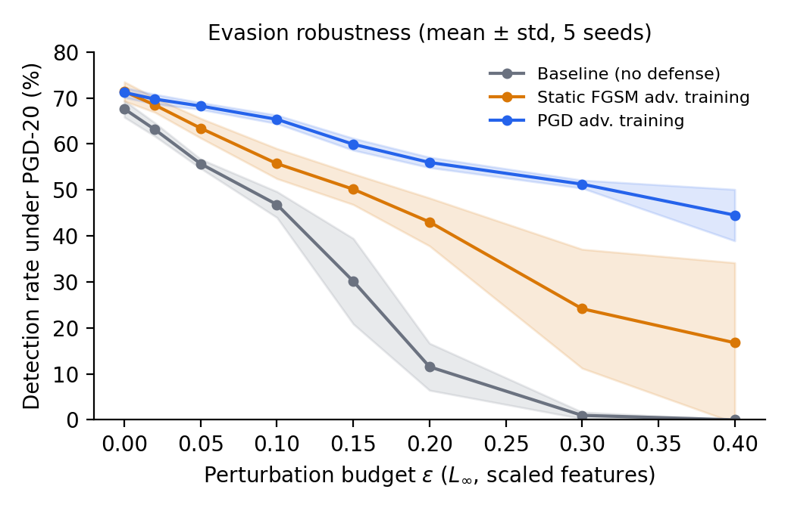
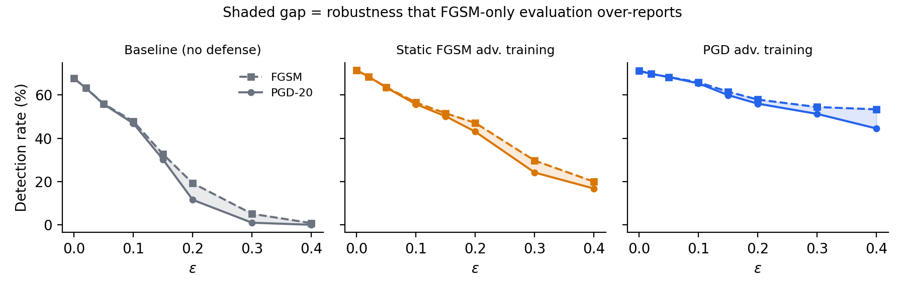

# Adversarial Evasion Attacks on ML Network Intrusion Detection

[](https://github.com/RohanTrivedi09/adversarial-nids-evasion/actions/workflows/tests.yml)

**Can an attacker slightly change their malicious traffic features so an ML-based
intrusion detector waves it through? And which defense actually stops that?**

This repo attacks a neural-network NIDS trained on **NSL-KDD** with white-box
**FGSM** and **PGD** evasion attacks, then compares two defenses: cheap
*static* FGSM adversarial training and Madry-style *PGD* adversarial training.
Everything (MLP, backprop, attacks, adversarial training) is written from
scratch in NumPy and gradient-checked. No adversarial-ML libraries are used.



## Key findings (5 seeds, mean ± std)

| Model | Clean DR | Clean FPR | DR under PGD, ε=0.1 | ε=0.2 | ε=0.3 |
|---|---|---|---|---|---|
| Baseline (no defense) | 67.6 ± 1.8 % | 6.1 % | 46.8 ± 2.8 % | 11.5 ± 5.1 % | **1.0 ± 0.7 %** |
| Static FGSM adversarial training | 71.4 ± 2.1 % | 7.2 % | 55.7 ± 3.3 % | 43.0 ± 5.2 % | 24.2 ± 12.9 % |
| **PGD adversarial training** | 71.2 ± 1.1 % | 7.6 % | **65.3 ± 0.9 %** | **56.0 ± 1.1 %** | **51.2 ± 0.9 %** |

*DR = detection rate on attack traffic (attack rows perturbed, normal rows untouched). FPR = false alarms on normal traffic. ε is an L∞ budget on min-max-scaled features. Full table: [`results/summary.csv`](results/summary.csv).*

1. **The undefended NIDS collapses.** At ε = 0.3 a PGD attacker evades detection on **99%** of malicious flows.
2. **Static FGSM adversarial training is unreliable.** It helps against weak attacks, but at ε = 0.3 its detection rate swings from near-zero to ~40% depending on the random seed (±12.9 points). Single-seed results would badly misreport it.
3. **PGD adversarial training is the only robust defense here.** It keeps **51%** detection at ε = 0.3 (vs 1% baseline) with low seed variance. The price is +1.5 points of false-positive rate on clean traffic.
4. **Evaluating with FGSM alone overstates robustness.** FGSM over-reports detection rate by up to **8.8 points** (PGD-trained model, ε = 0.4) and 5.5 points for static FGSM-AT (ε = 0.3). Always evaluate with a multi-step attack.
5. **Accuracy hides the security trade-off.** Adversarial training *raises* clean detection rate while also raising FPR. Only reporting DR and FPR separately shows both.



## Threat model

| | |
|---|---|
| Attacker knowledge | White-box (model weights, gradients) |
| Attacker goal | Evasion: attack traffic classified as normal |
| What is perturbed | Only malicious flows; benign traffic is never touched |
| Budget | ‖δ‖∞ ≤ ε on [0, 1]-scaled features, outputs clipped to [0, 1] |
| Feature constraint | Only the **38 continuous** features. The 84 one-hot `protocol` / `service` / `flag` dummies are frozen, because "0.1 of a TCP flag" is not real traffic. |

**Limitation:** this is a *feature-space* attack. A real attacker must also produce
valid packets that map to the perturbed features (problem-space constraints,
feature dependencies such as `src_bytes` vs `count`). That is future work.

## Method

- **Data:** NSL-KDD `KDDTrain+` (125,973 flows) / `KDDTest+` (22,544 flows, includes attack types unseen in training). Binary label: normal vs attack.
- **Preprocessing:** log1p on heavy-tailed counts/bytes, min-max scaling fit on train only, one-hot categoricals (train vocabulary) → 122 features.
- **Model:** MLP 122 → 64 → 32 → 1 (ReLU, sigmoid), BCE loss, Adam, 10 epochs.
- **Attacks:** FGSM (1 step) and PGD (20 steps, step 2.5ε/20, random start).
- **Defenses:**
  - *Static FGSM-AT:* FGSM examples crafted **once** against a pre-trained baseline and added to the training set.
  - *PGD-AT:* PGD-7 examples regenerated **every mini-batch** against the current model, 50/50 clean/adversarial, ε_train = 0.1.
- **Protocol:** 5 seeds; metrics are detection rate, FPR, precision, F1 and accuracy.

## Reproduce

```bash
python -m venv .venv && source .venv/bin/activate
pip install -r requirements.txt
make test          # finite-difference gradient checks + attack constraint tests
make experiments   # ~4 min on a laptop CPU, downloads NSL-KDD automatically
make figures
```

## Repository layout

```
src/nids_adv/
  data.py       NSL-KDD download + preprocessing + attackable-feature mask
  model.py      NumPy MLP with manual backprop and input gradients
  attacks.py    FGSM, PGD, attack-traffic-only perturbation
  train.py      baseline, static FGSM-AT, PGD-AT
  metrics.py    DR, FPR, precision, F1, evasion rate
scripts/        run_experiments.py, make_figures.py
tests/          gradient check, budget/mask/box constraints
results/        results.csv (per seed), summary.csv (mean ± std)
figures/        plots used above
```

## References

- Goodfellow, Shlens, Szegedy. *Explaining and Harnessing Adversarial Examples.* ICLR 2015.
- Madry et al. *Towards Deep Learning Models Resistant to Adversarial Attacks.* ICLR 2018.
- Athalye, Carlini, Wagner. *Obfuscated Gradients Give a False Sense of Security.* ICML 2018.
- Tavallaee et al. *A Detailed Analysis of the KDD CUP 99 Data Set.* CISDA 2009.
- Apruzzese et al. *Modeling Realistic Adversarial Attacks against Network Intrusion Detection Systems.* DTRAP 2022.

## License

MIT
